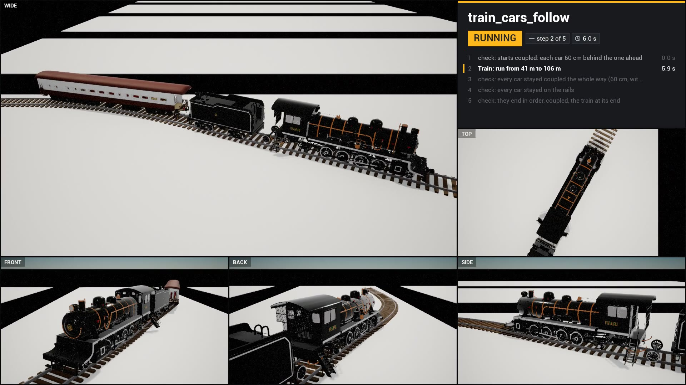

# Worked example: a train on a track

Seven play tests for a simple train system, as they were built and run (all pass headless in about 40 s; with videos a
few minutes). Use them as a model: ask Claude for "tests like the train example" for your own vehicles.



## What's being tested

- **A track**: a spline, with rails and sleepers laid along it in short straight pieces (so they follow curves).
- **A train**: waits at its start; told to go, speeds up (1.5 m/s²) to its top speed (4 m/s) and brakes (2 m/s²) to stop
  at its end; backs up when the end is behind it. It integrates in steps of at most 1/120 s, so it runs the same at any
  frame rate. Its position is its middle, as a distance along the track.
- **Cars** (a tender, a coach): coupled ones ride 60 cm behind the unit ahead, placed along the track. `Couple` takes a
  car standing within 30 cm of the coupled place; `Uncouple` leaves a car (and those behind it) rolling at the train's
  speed, braking to a stop.

Each test has its own floor, 120 m long, with a 110 m track.

## The cases

| Case | Arena and action | Checks |
| --- | --- | --- |
| `train_starts_at_start` | a straight track, the train's middle at 10 m | at its start (10 cm), on the rails (2 cm), facing along them (1°); still there after 2 s untold; moves off when told |
| `train_arrives_at_end` | runs to 95 m | stops within 10 cm of its end; on time within 5% of the trip its speeds give; never past its end; never over its top speed |
| `train_stops_at_a_set_end` | its end set half way | stops at 50 m, not the track's end |
| `train_follows_a_curve` | an S-curve | never more than 2 cm off the rails, all the way; stops at its end |
| `train_cars_follow` | locomotive, tender, coach on the S-curve | every gap within 2 cm of 60 cm the whole way, measured from where the cars stand; every car on the rails; in order at the end |
| `train_uncouples_a_car` | the coach uncoupled at top speed | the coach is off, the tender still on; the train stops at its end; the coach rolls to a stop at least 10 m back and stays put |
| `train_couples_a_car` | a coach standing 20 m behind | won't couple it from there; backs up until 60 cm from it; couples it; pulls it 50 m, coupled all the way |

## How they're written

Helpers on the test actor: `Train(points, start, end)` (a track through points in the test's frame, and a train on it),
`AddCar(train, kind)` (coupled behind its last unit), `LooseCar(train, kind, distance)`, and a step `RunTrain(train,
end)` that starts the trip and, every frame until it's over, measures from the world:

```cpp
// every unit: how far off the rails? every coupled car: its gap to the one ahead, from where they stand on the track
float Off = 0.f;
TrainFurthest = FMath::Max(TrainFurthest, Track->DistanceOf(Train->GetActorLocation(), &Off));   // nearest point on the spline
TrainOff = FMath::Max(TrainOff, Off);
const AActor* Ahead = Train; float AheadHalf = Train->HalfLength();
for (const ACar* C : Train->Cars)
{
    Track->DistanceOf(C->GetActorLocation(), &Off);
    TrainOff = FMath::Max(TrainOff, Off);
    const float Gap = (Track->DistanceOf(Ahead->GetActorLocation()) - AheadHalf) - (Track->DistanceOf(C->GetActorLocation()) + C->HalfLength());
    TrainGapOff = FMath::Max(TrainGapOff, FMath::Abs(Gap - ATrain::CouplerGap));
    Ahead = C; AheadHalf = C->HalfLength();
}
TrainTop = FMath::Max(TrainTop, Train->Speed);
return Train->bArrived;
```

A case then reads like its description:

```cpp
{ "train_couples_a_car", [](T& t) {
    ATrain* N = t.Train({ { -400, 0 }, { 10600, 0 } }, 6500.f, 10000.f);
    t.AddCar(N, TEXT("tender"));
    ACar* Coach = t.LooseCar(N, TEXT("coach"), 2000.f);           // standing on the track behind it
    t.Check("won't couple it from far off", [N, Coach] { return N->Couple(Coach) ? FString(TEXT("it coupled a car 20 m away")) : FString(); });
    t.RunTrain(N, N->DistanceToCouple(Coach));                    // backs up until its tender meets the coach
    t.Check("backs up onto it: 60 cm from the coach", [N, Coach] { /* the measured gap within 5 cm of 60 */ });
    t.Check("couples it", [N, Coach] { return N->Couple(Coach) ? FString() : FString(TEXT("it wouldn't couple")); });
    t.RunTrain(N, 9800.f);
    t.Check("the coach comes along, coupled", [&t, N] { return t.TrainGapOff <= 2.f ? FString() : FString::Printf(TEXT("a gap was %.1f cm off"), t.TrainGapOff); });
} },
```

## What the tests found while it was built

- At 4x in the editor the train arrived 6% early: it was stepped a frame at a time. Fixed with small fixed steps.
- A material in the locomotive's pack logged an error the first time it drew, failing whichever test was running though
  every check had passed (pitfalls.md).
- The wheels of the scaled models touched down about 1 m either side of the middle, but the rails were standard gauge:
  only the video showed it (the checks measured the train's middle). Rails moved under the wheels.

The meshes in the pictures are free on Fab: the "Korean Railroad Mika 3 161" locomotive and the "Korean Presidential
Coach", both by KCISA, CC-BY ("Provided by KCISA"). They're not in this repo; the tests run with blocks in their place.
