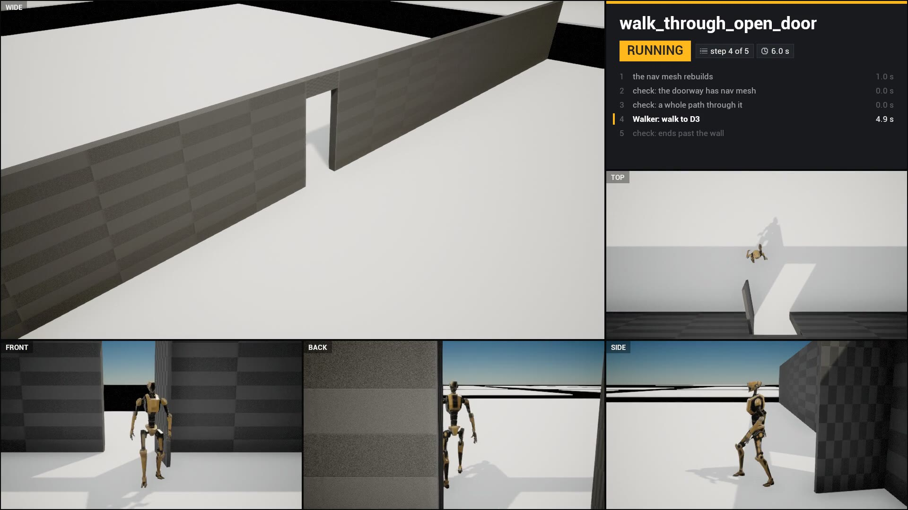
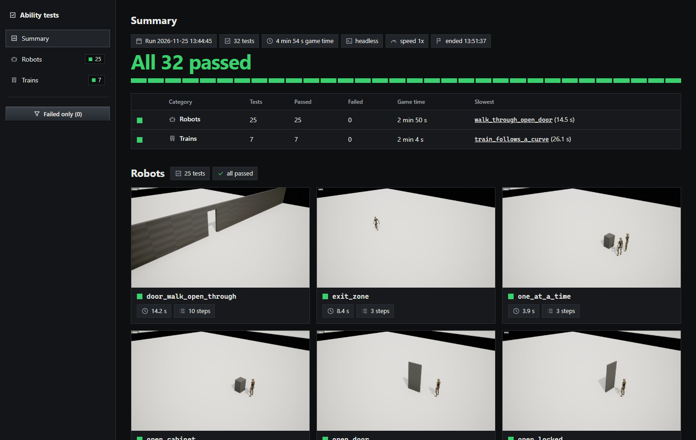
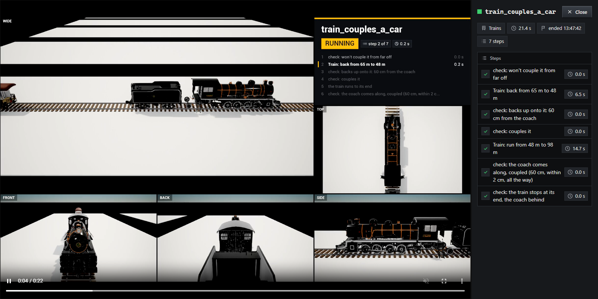

# unreal-play-tests

Automated play tests for your Unreal Engine game, written for you by Claude Code.

You type `/play-tests` in Claude Code at the root of your Unreal project. Claude reads your game, proposes what to test,
and once you agree, builds the tests. Each test builds a small arena, plays your game's own code (a character walking
through a door, a train coupling a car), and checks the world afterwards. Every test is recorded from five cameras, and
every run ends in a report you can click through.

There's no plugin to install and no code here to keep in sync: this repo is a Claude Code skill. It's the instructions,
the traps to avoid and the templates Claude needs to build the framework inside your project, in your project's style.

## Why

Every change you make to a game can break something you finished weeks ago. Play tests re-check all of it after every
change, in a minute or two, and show you the video of what broke. Nobody enjoys writing tests, though, which is exactly
why this is a job to hand to an AI: you decide what matters, Claude writes and runs them.

## What you get

- **Tests**: Unreal Functional Tests (`AFunctionalTest`), one per case, each on its own floor in a test level. They drive
  your real code, not shortcuts, and they measure the result from the world, with tolerances ("stops within 10 cm",
  "on time within 5%").
- **A test screen**: while a test plays, the window shows five cameras of the test's own (wide, top, front, back, side)
  and a panel with the test's name, state, steps and time. The screen is recorded to video, a true 30 fps from the
  headless runner.
- **A report**: one HTML page per run, dark, with a side nav. It opens on a summary table per category; every test has
  a card with a still, and opening one plays its video full screen beside its timed steps.
- **One command to run everything**: `Scripts/run_tests.sh` (or `run_tests.ps1`) builds, runs every test headless and
  opens the report. `--fast` skips the videos.

## Install

1. Copy `.claude/skills/play-tests/` from this repo into your Unreal project's `.claude/skills/` (or into
   `~/.claude/skills/` to have it in every project).
2. Open Claude Code at your project's root and type `/play-tests`.

You need:

- **Claude Code**;
- **a C++ Unreal Engine project** (built and tested on UE 5.8, on Windows);
- **Visual Studio's build tools**, which your C++ project already uses;
- **ffmpeg on your PATH**, for the videos;
- **Git Bash** for `run_tests.sh`, or PowerShell for `run_tests.ps1`.

An Unreal MCP server helps Claude build the test level inside the open editor, but isn't required: Claude can give you
a Python script to run there.

## What Claude does

1. Reads your `.uproject`, `Source/` and `Config/`, and lists your game's systems and abilities in plain words.
2. Proposes a test plan by category, each case with its arena, its action and numbered checks. You agree it first.
3. Builds the framework in your module: the test actor, its screen and recording, the test level, the report and the
   run script ([framework.md](.claude/skills/play-tests/framework.md), [test-screen.md](.claude/skills/play-tests/test-screen.md)).
4. Writes the cases ([writing-tests.md](.claude/skills/play-tests/writing-tests.md)).
5. Builds and runs them, and reads every failure: a real bug in your game (it tells you, with the video), a mistake in
   the test (it fixes it and says so), or one of Unreal's traps ([pitfalls.md](.claude/skills/play-tests/pitfalls.md)).
6. Opens the report and hands over: what's covered, what it found, how to add a case.

When you add a feature later, ask Claude for its tests. It adds them and runs everything, and anything that used to pass
and now fails is a regression.

## Example

[examples/train.md](examples/train.md) covers seven tests of a train on a track: starting, stopping on its mark and on
time, curves, cars that stay coupled, uncoupling at speed and coupling up again.

## Credits

The locomotive and coach in the pictures are free on Fab: "Korean Railroad Mika 3 161" and "Korean Presidential Coach",
both provided by KCISA under CC-BY. They aren't included here.

## Licence

MIT: see [LICENSE](LICENSE).
