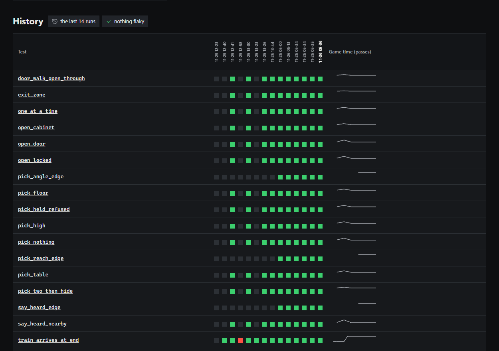
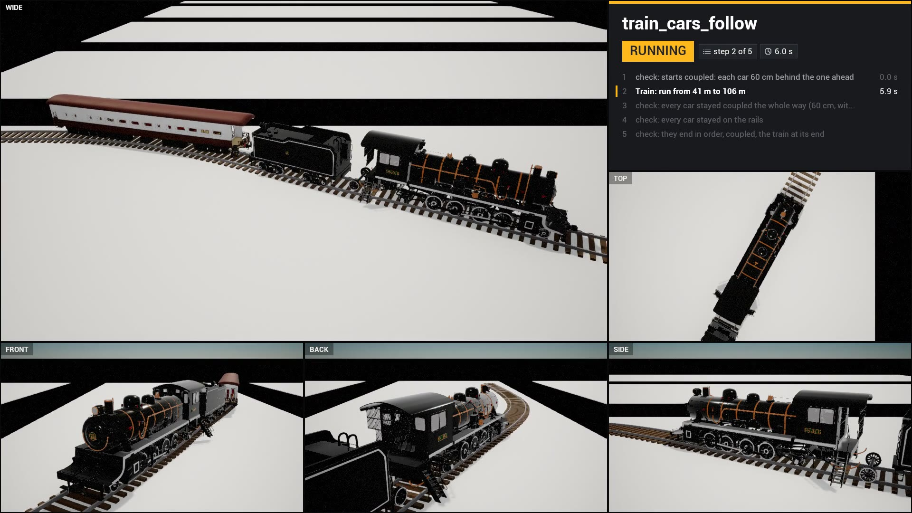

# unreal-play-tests

Automated play tests for your Unreal Engine game, written for you by Claude Code.

You type `/play-tests-create` in Claude Code at the root of your Unreal project. Claude reads your game, proposes what to
test, and once you agree, builds the tests. Each test builds a small arena, plays your game's own code (a character walking
through a door, a train coupling a car), and checks the world afterwards. Every test is recorded from five cameras, and
every run ends in a report you can click through.

There's no plugin to install and no code here to keep in sync: this repo is three Claude Code skills, one for each job.
They're the instructions, the traps to avoid and the templates Claude needs to build the framework inside your project, in
your project's style.

| Skill | What it does | When |
|---|---|---|
| `/play-tests-create` | Reads your game, proposes the tests, builds the framework the first time, writes the tests; later, adds tests for a new feature | Once to set up, then for each new feature |
| `/play-tests-run` | Builds your game, runs every test headless (faster than real time), and tells you what passed, what failed and what changed since the last run | After every change |
| `/play-tests-fix` | Watches a failing test's video, works out whether your game, the test or an Unreal trap is at fault, and fixes the right thing | When a test goes red |

## Why

Every change you make to a game can break something you finished weeks ago. Play tests re-check all of it after every
change, in a minute or two, and show you the video of what broke. Nobody enjoys writing tests, though, which is exactly
why this is a job to hand to an AI: you decide what matters, Claude writes and runs them.

## What you get

- **Tests**: Unreal Functional Tests (`AFunctionalTest`), one per case, each on its own floor in a test level. They drive
  your real code, not shortcuts, and they measure the result from the world, with tolerances ("stops within 10 cm",
  "on time within 5%"). Every feature gets three kinds of test: **positive** (it does what it should), **negative** (it
  refuses or stops when it should) and **boundary** (just inside and just outside each limit in your code).
- **A test screen**: while a test plays, the window shows five cameras of the test's own (wide, top, front, back, side)
  and a panel with the test's name, state, steps and time. The screen is recorded to video, a true 30 fps from the
  headless runner.
- **A report**: one HTML page per run, dark, with a side nav. It opens on a summary: the version of your game it tested
  (git commit and uncommitted changes), the regressions since earlier runs and the version each last passed at, flaky
  tests, a table per category, and a table of features by kind that flags gaps (a feature with no negative test). Every
  test has a card with a still, grouped by kind, and opening one plays its video full screen beside its timed steps. A
  History section shows each test's last runs side by side, with a line of its game time.
- **One command to run everything**: `Scripts/run_tests.sh` (or `run_tests.ps1`) builds, runs every test headless and
  opens the report. `--fast` skips the videos; `--build-level` rebuilds the test level after you add a case;
  `--repeat 3` runs everything three times to find flaky tests.

## Install

1. Copy the three folders in this repo's `.claude/skills/` (`play-tests-create`, `play-tests-run`, `play-tests-fix`)
   into your Unreal project's `.claude/skills/` (or into `~/.claude/skills/` to have them in every project). Keep them
   together: run and fix read the shared guides inside `play-tests-create`.
2. Open Claude Code at your project's root and type `/play-tests-create`.

You need:

- **Claude Code**;
- **a C++ Unreal Engine project** (built and tested on UE 5.8, on Windows);
- **Visual Studio's build tools**, which your C++ project already uses;
- **ffmpeg on your PATH**, for the videos;
- **Git Bash** for `run_tests.sh`, or PowerShell for `run_tests.ps1`.

Your editor doesn't need to be open: Claude builds the test level and runs the tests in a headless editor. It turns on
Unreal's Python Editor Script Plugin, which builds the level, and keeps the tests out of Shipping builds.

## What Claude does (`/play-tests-create`)

1. Reads your `.uproject`, `Source/` and `Config/`, and lists your game's systems and abilities in plain words.
2. Proposes a test plan by category, each case with its arena, its action, numbered checks and its kind, with a
   boundary pair for each limit it finds in your code. You agree it first.
3. Builds the framework in your module: the test actor, its screen and recording, the test level, the report and the
   run script ([framework.md](.claude/skills/play-tests-create/framework.md), [test-screen.md](.claude/skills/play-tests-create/test-screen.md)).
4. Writes the cases ([writing-tests.md](.claude/skills/play-tests-create/writing-tests.md)).
5. Builds and runs them (`/play-tests-run`), and reads every failure (`/play-tests-fix`): a real bug in your game (it tells you, with the video), a mistake in
   the test (it fixes it and says so), or one of Unreal's traps ([pitfalls.md](.claude/skills/play-tests-create/pitfalls.md)).
6. Opens the report and hands over: what's covered, what it found, how to add a case.

When you add a feature later, run `/play-tests-create` again (or just ask Claude for its tests). It adds them and runs everything, and the report counts anything that used to
pass and now fails as a regression. A bug you find gets its own test before it's fixed.

## Running the tests

Ask Claude (`/play-tests-run`): it checks your editor is closed, picks a quick or a full run, and tells you what passed,
what failed and whether a failure is a real regression or a flaky test. Or run them yourself, with one command from your
project's root. **Close your
project's editor first**: the script builds your game, and the build can't replace its DLLs while the editor holds them.

| What | PowerShell | Git Bash |
|---|---|---|
| Every test, each recorded to video | `.\Scripts\run_tests.ps1` | `bash Scripts/run_tests.sh` |
| Only the tests whose names start with `driving_brakes` (several: comma-separated, one run) | `.\Scripts\run_tests.ps1 -Filter driving_brakes` | `bash Scripts/run_tests.sh driving_brakes` |
| Quick: nothing drawn, no videos | `.\Scripts\run_tests.ps1 -Fast` | `bash Scripts/run_tests.sh --fast` |
| After adding or renaming a test (rebuild the test level) | `.\Scripts\run_tests.ps1 -BuildLevel` | `bash Scripts/run_tests.sh --build-level` |
| Three runs on the same code, to find flaky tests | `.\Scripts\run_tests.ps1 -Fast -Repeat 3` | `bash Scripts/run_tests.sh --fast --repeat 3` |

Each run prints every result and the totals, then opens its report (`Saved/TestRecordings/<date_time>/report.html`).
Set `NO_OPEN=1` to leave the report closed (in a scheduled run, say).

**Faster than real time.** The script runs on a fixed time step: every frame is exactly 1/30 s of game time, computed as
fast as your machine can go, the same steps every run. With `-Fast` / `--fast` nothing is drawn, so minutes of gameplay
take seconds: one project's 36 tests hold about two and a half minutes of walking, opening and picking up, and run in about
7 seconds (plus 15 or so to start the editor). Recording the videos draws every frame, so a full run with videos takes
longer (that project: about 7 minutes; the ten Vehicle template tests: about 3). Use `--fast` while you work, the videos
when you want to see what happened.

**Watching them in the editor.** Open the test level and run them from Tools > Session Frontend > Automation, or the
console: `Automation RunTests L_PlayTests`. In the editor they play at 4x speed; `game.TestSpeed 1` in the console slows
them to real time (`game.TestSpeed 8` speeds them up), and `game.TestRecord 1` records videos as they play (at 1x).

## Examples

Both ship inside the skill, so Claude can read them in your project:

- [examples/vehicle.md](.claude/skills/play-tests-create/examples/vehicle.md): ten tests of Epic's C++ Vehicle template,
  written by a fresh Claude with nothing but this skill, in about 40 minutes from `/play-tests` (now `/play-tests-create`) to a green report. They
  cover acceleration, braking, turning, a wall hit, flipping back, respawning and a ramp. Along the way it caught its
  own test mistakes and a hollow pass, and found a respawn quirk in the template.
- [examples/train.md](.claude/skills/play-tests-create/examples/train.md): seven tests of a train on a track: starting,
  stopping on its mark and on time, curves, cars that stay coupled, uncoupling at speed and coupling up again.

## Credits

The locomotive and coach in the pictures are free on Fab: "Korean Railroad Mika 3 161" and "Korean Presidential Coach",
both provided by KCISA under CC-BY. They aren't included here.

## Licence

MIT: see [LICENSE](LICENSE).
